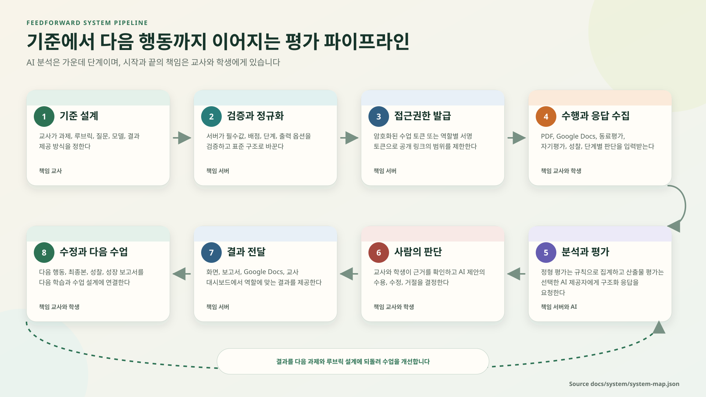

# Feedforward 시스템 파이프라인

Feedforward의 공통 파이프라인은 교사가 평가 기준을 설계하고, 시스템이 이를 검증해 제한된 접근권한을 발급하며, 교사와 학생의 수행을 수집한 뒤, 규칙 또는 AI로 분석하고, 사람이 결과를 판단하여 다음 행동으로 연결하는 흐름입니다. AI는 다섯 번째 단계의 분석 도구이며 평가의 시작점이나 최종 결정자가 아닙니다.



## 1 공통 평가 파이프라인

| 단계 | 책임 | 입력 | 처리 | 출력과 완료 조건 |
| --- | --- | --- | --- | --- |
| 1 기준 설계 | 교사 | 과제, 루브릭, 질문, 배점, 모델, 결과 제공 방식 | 평가 목적을 관찰 가능한 기준과 학생이 이해할 수 있는 질문으로 바꾼다 | 필수값과 배점이 정해지고 교사가 설명할 수 있는 평가안 |
| 2 검증과 정규화 | 서버 | 교사가 입력한 평가안 | 공백 제거, 기본값 적용, 단계와 배점 범위 제한, 출력 옵션 검증 | 기능별 표준 설정 객체. 오류가 있으면 발급 전에 구체적 메시지 반환 |
| 3 접근권한 발급 | 서버 | 표준 설정, 교사와 평가 식별자, 역할 | 범용 흐름은 AES 256 GCM 암호화 토큰을 만들고 프로젝트 4는 HMAC 서명 토큰을 만든다 | 필요한 범위와 기간만 가진 링크 또는 토큰 |
| 4 수행과 응답 수집 | 교사와 학생 | PDF, Google Docs URL, 동료평가, 자기평가, 성찰, 단계별 판단 | 파일 형식과 크기, 문서 주소, 필수 응답, 토큰 역할을 검사한다 | 검증된 평가 입력. 실패한 입력은 저장 또는 외부 전송 전에 중단 |
| 5 분석과 평가 | 서버와 AI | 루브릭, 과제, 검증된 입력 | 정형 응답은 규칙으로 집계하고 산출물은 OpenAI 또는 Anthropic에 구조화 응답을 요청한다 | 점수, 기준별 근거, 강점, 개선점, 다음 행동 또는 집계 결과 |
| 6 사람의 판단 | 교사와 학생 | AI 제안, 동료 의견, 수행 근거 | 근거를 대조하고 제안의 수용, 수정, 거절을 결정한다 | 교육적 책임을 가진 사람이 확인한 판단과 필요한 수정 계획 |
| 7 결과 전달 | 서버 | 검토된 결과와 역할 | 화면, PDF 또는 HTML 보고서, Google Docs, 교사 대시보드에서 필요한 내용만 보여 준다 | 수신자가 결과의 근거와 다음 행동을 이해한다 |
| 8 수정과 다음 수업 | 교사와 학생 | 다음 행동, 최종본, 성찰, 성장 데이터 | 학생은 산출물을 수정하고 교사는 공통 오개념과 필요한 지원을 다음 수업에 반영한다 | 최종본, 성찰, 성장 보고서, 다음 과제와 루브릭 변경 |

파이프라인은 8단계에서 끝나지 않습니다. 결과를 다음 1단계의 과제와 루브릭 설계에 되돌려 수업을 개선할 때 한 주기가 완성됩니다.

## 2 기능별 분기

### 2.1 일반 PDF와 Google Docs 평가

현재 기본 운영은 학생이 사이트에 직접 제출하는 방식이 아니라 교사가 학생 작품을 직접 평가하는 방식입니다. `studentSubmissionLinksEnabled`가 `false`이므로 학생 제출 링크는 닫혀 있고, 교사는 저장한 평가 설정에서 단기 평가 토큰을 발급해 PDF 또는 문서를 평가합니다.

1. 교사가 `/teacher` 또는 `/docs/teacher`에서 과제, 루브릭, 모델, 결과 제공 방식을 저장합니다.
2. 서버는 평가 설정과 API 키를 분리합니다. 설정은 교사별 Blob JSON에 저장하고 API 키는 AES 256 GCM으로 암호화합니다.
3. 교사가 직접 평가를 시작하면 `/api/teacher/evaluation-token`이 교사용 제출 모드가 포함된 토큰을 만듭니다.
4. PDF는 `/api/evaluate`, Google Docs는 `/api/evaluate-doc`으로 전달됩니다. PDF는 15MB 이하만 받습니다. Google Docs 주소는 `docs.google.com` 문서만 허용합니다.
5. 공개 Google Docs는 텍스트 내보내기 주소로 읽고, 비공개 문서에 결과를 추가할 때에는 교사가 연결한 Google OAuth 권한을 사용합니다.
6. 모델 응답은 제목, 총점, 기준별 점수와 피드백, 강점, 개선점, 다음 행동을 가진 구조로 받습니다.
7. 선택한 출력 옵션에 따라 화면, 보고서, Google Docs로 결과를 전달합니다.

오류 처리의 원칙은 외부 제공자의 상세 오류에서 비밀정보를 제거하고 사용자가 수정할 수 있는 메시지만 돌려주는 것입니다. 외부 API가 실패하면 저장된 평가 설정이나 원본 파일을 자동으로 재전송하지 않습니다.

### 2.2 동료평가와 자기평가

동료평가와 자기평가는 질문 유형을 점수, 수준 선택, 서술형으로 정규화하고 응답을 교사와 평가 식별자 아래에 저장합니다. 기본 화면은 개인정보 보호를 이유로 Feedforward 내부 동료응답 수집 대신 Google Form 안내를 사용합니다. 다만 세션과 서버 모듈에는 내부 응답 저장 기능이 남아 있으므로 운영 정책과 기능 플래그를 함께 확인해야 합니다.

동료평가 질문은 교사가 직접 만들거나 `/api/ai/generate-questions`에서 생성할 수 있습니다. AI가 만든 질문도 저장 전에 교사가 검토해야 합니다. 질문 생성은 평가를 대신하지 않으며, 질문의 적절성, 관찰 가능성, 학생 언어 수준을 확인하는 단계입니다.

### 2.3 단계형 통합 평가 세션

세션은 PDF, Google Docs, 동료평가, 자기평가, 성찰을 교사가 원하는 순서로 묶습니다. 각 단계는 `required` 여부를 가지며 세션 전체는 하나 이상의 단계를 가져야 합니다.

```text
세션 설정
  -> 단계별 토큰화
  -> 학생 신원과 모둠 정보 입력
  -> PDF 또는 Docs AI 평가
  -> 동료평가
  -> 자기평가
  -> 성찰
  -> 응답 저장
  -> 최소 동료응답 수와 익명화 조건 확인
  -> 학생 결과 공유 또는 교사 전용 결과
```

학생 결과 공유는 기본적으로 꺼져 있습니다. 교사가 켜더라도 `minPeerResponses`를 만족하고 익명화 설정을 적용해야 합니다. 점수형 응답과 서술형 응답을 같은 방식으로 평균내지 않으며, 성찰은 점수 0으로 보존해 평가 점수와 학습 기록을 구분합니다.

### 2.4 계절의 비밀 프로젝트 8단계

프로젝트 4는 공통 파이프라인을 수업 순서에 맞춰 구체화한 대표 흐름입니다. 교사가 `openStage`와 `groupReviewOpen`을 조정하여 아직 준비되지 않은 단계를 열지 않도록 통제합니다.

| 단계 | 학생 활동 | 시스템 처리 | 교육적 산출물 |
| --- | --- | --- | --- |
| 1 모둠 내 동료평가 | 같은 모둠 학생의 초안 또는 역할 수행을 기준에 따라 평가 | 응답 저장, 모둠별 조회 | 구체적 강점과 수정 의견 |
| 2 내가 받은 평가 확인 | 받은 의견과 점수를 읽고 근거를 확인 | 작성자와 수신자 범위에 맞게 결과 구성 | 수정 후보 목록 |
| 3 대표 작품 선정 | 모둠에서 대표 대본과 선정 이유를 정한다 | 선택 기록과 이유를 분리 저장한 뒤 합성 | 모둠 공동 판단과 근거 |
| 4 다른 모둠 발표 평가 | 다른 모둠의 설명을 6개 기준으로 평가 | 발표 평정과 기억에 남은 점 저장 | 청중 관점의 설명 품질 자료 |
| 5 AI 피드백 판단 | AI 제안별 수용 또는 거절과 이유를 정한다 | 중복 생성 제어, 구조화 피드백 저장 | AI를 비판적으로 사용하는 판단 기록 |
| 6 최종 대본 제출 | 판단을 반영한 최종 대본을 제출한다 | 최종본 저장 | 수정된 산출물 |
| 7 후배 평가 | 후배가 사전 문항, 모둠 평가, 사후 문항에 응답한다 | 학급 매핑, 퀴즈 채점, 모둠별 집계 | 실제 청중의 이해 가능성 자료 |
| 8 결과 확인과 자기평가 | 모둠, 발표, AI, 후배 결과를 보고 성찰한다 | 성장 영역을 통합하고 보고서 생성 | 개인 성장 보고서와 다음 행동 |

프로젝트 4의 AI 단계는 자동 채점 단계가 아닙니다. 학생이 제안마다 수용 또는 거절을 기록하고 이유를 남기는 구조가 핵심입니다. 따라서 성공 지표는 AI 제안 수용률이 아니라 판단 이유의 구체성과 최종본의 개선입니다.

### 2.5 프로젝트별 워크스페이스와 전시

`/project1`, `/project_expo`, `/meta1`, `/confesta`는 프로젝트별 루브릭과 AI 피드백을 빠르게 시범 운영하는 독립 워크스페이스입니다. 각 워크스페이스는 Vercel Blob 기반 `get`, `set`, `list` 저장 API와 Anthropic 프록시를 사용합니다. 현재 유사 코드가 반복되므로 장기적으로 공통 저장, 인증, 입력 검증, AI 호출 어댑터로 합쳐야 합니다.

`/showcase`는 학습 결과 전시와 방명록을 담당합니다. 방명록은 게시 전 상태, 공개, 숨김을 구분하고 관리자 답변을 저장합니다. 쓰기 요청은 요청 크기, 동일 출처, 연락처 패턴, 게시 간격을 검사하며 관리 작업은 서명된 관리자 쿠키가 필요합니다.

## 3 데이터 생명주기

| 시점 | 데이터 | 저장 여부 | 통제 |
| --- | --- | --- | --- |
| 평가 설계 | 과제, 루브릭, 질문, 모델, 출력 옵션 | 교사별 비공개 Blob | 교사 ID와 평가 ID로 분리 |
| 비밀정보 등록 | OpenAI와 Anthropic API 키, Google OAuth 토큰 | 암호화한 비공개 Blob | 서버 전용 암호화 키, 응답에서 원문 제거 |
| 제출 | PDF 파일 또는 Google Docs 본문, 응답 | 일반 평가 파일은 요청 중 처리. 세션과 프로젝트 응답은 기능별 Blob에 저장 | 형식, 크기, 토큰, 역할 검증 |
| 분석 | 모델 입력과 구조화 결과 | 기능별로 결과 저장 여부가 다름 | 제공자 선택, 서버 측 호출, 구조 검증 |
| 결과 | 평가, 판단, 최종본, 성찰, 성장 보고서 | 세션과 프로젝트 흐름에서 저장 | 역할별 조회, 교사 대시보드 |
| 종료 | 프로젝트 데이터, 평가 설정, 로그 | 현재 공통 자동 파기 작업은 확인되지 않음 | 목표는 `expiresAt`, 예약 삭제, 삭제 확인 기록 |

보유기간은 정책 문구만으로 집행되지 않습니다. 데이터 객체마다 만료 시각을 기록하고, 삭제 작업이 성공했는지 확인하는 운영 파이프라인이 필요합니다.

## 4 실패와 재시도 규칙

- 입력 검증 실패는 외부 AI 호출과 저장 전에 종료합니다.
- 토큰이 잘못되었거나 만료되면 새 링크 또는 재로그인을 요구합니다.
- 외부 AI가 실패하면 같은 요청의 자동 무한 재시도를 금지합니다. 사용자가 원본을 확인하고 명시적으로 다시 시도합니다.
- Blob 읽기는 프로젝트 4 저장소에서 동시 읽기 수를 제한하고 일시 오류를 재시도합니다.
- 방명록 업데이트는 ETag 충돌을 별도 오류로 처리하여 다른 관리자의 변경을 덮어쓰지 않습니다.
- AI 생성 작업은 생성 ID와 상태를 사용해 같은 모둠의 중복 실행을 막습니다.
- 오류 로그에는 학생 답안, 문서 본문, API 키, OAuth 토큰을 기록하지 않습니다.

## 5 운영 지표

점수 평균만으로 파이프라인 품질을 판단하지 않습니다. 다음 지표를 함께 봅니다.

| 관점 | 지표 | 해석 |
| --- | --- | --- |
| 접근 | 단계 진입 성공률, 토큰 만료율, 제출 오류율 | 사용자가 수업 흐름에 진입할 수 있는지 확인 |
| 품질 | 루브릭 항목 누락률, 총점 불일치율, 근거 없는 피드백 비율 | 구조화 결과의 신뢰성 확인 |
| 주체성 | AI 제안별 수용과 거절 이유 작성률, 최종본 수정률 | 학생이 AI를 판단했는지 확인 |
| 다면성 | 동료, 발표, 후배 평가 응답 수와 편차 | 한 관점에 치우치지 않았는지 확인 |
| 운영 | AI 응답시간, 외부 API 오류율, Blob 충돌률 | 병목과 장애 원인 확인 |
| 개인정보 | 직접 식별정보 외부 전송 탐지 건수, 만료 데이터 삭제 성공률 | 정책이 실제로 집행되는지 확인 |

## 6 코드와 문서 품질 파이프라인

시스템 변경은 다음 순서로 검증합니다.

```text
변경 제안
  -> system-map과 설명 문서 갱신
  -> 실제 Route Handler와 문서 동기화 검사
  -> 애플리케이션 소스 ESLint
  -> TypeScript 정적 검사
  -> Next.js 프로덕션 빌드
  -> 개인정보와 외부 전송 필드 대조
  -> 배포 승인
```

로컬에서는 `npm run pipeline`을 실행합니다. GitHub Actions도 같은 명령을 사용하며 `.next/cache`를 보존해 Next.js 16 빌드 시간을 줄입니다. 기능 변경이 없고 문서만 바뀌어도 시스템 지도와 API 인벤토리 검사는 생략하지 않습니다.

## 7 책임 분담

| 결정 | 교사 | 학생 | 시스템 운영자 | AI 제공자 |
| --- | --- | --- | --- | --- |
| 평가 목적과 루브릭 | 최종 책임 | 이해 가능성 피드백 | 편집 도구 제공 | 책임 없음 |
| 개인정보 최소화 | 입력 전 확인 | 불필요한 개인정보 입력 자제 | 기술적 차단과 삭제 | 계약 범위 내 처리 |
| AI 제안 생성 | 모델과 지시 선택 | 결과 검토 | 안전한 호출과 구조 검증 | 제안 생성 |
| 최종 평가 | 최종 책임 | 이의와 성찰 제시 | 근거와 변경 이력 제공 | 최종 권한 없음 |
| 데이터 삭제 | 요청과 수업 종료 확인 | 삭제 요청 가능 | 삭제 실행과 확인 | 제공자 정책에 따른 삭제 |

파이프라인의 책임이 명확해야 “AI가 평가했다”는 표현을 피할 수 있습니다. AI는 제안을 생성하고, 교사는 평가를 책임지며, 학생은 제안을 판단하고 자신의 다음 행동을 선택합니다.
