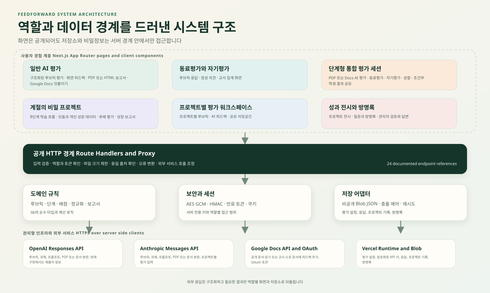

# Feedforward 시스템 구조

Feedforward는 Next.js 16 App Router 애플리케이션 하나 안에 교사용 평가 보관함, 범용 평가, 단계형 세션, 프로젝트별 평가, 성과 전시를 함께 운영합니다. 브라우저는 공개된 Route Handler만 호출하고 비공개 Blob, API 키, OAuth 토큰, 외부 AI 호출은 Node.js 서버 경계에서 처리합니다.



## 1 시스템 경계

### 1.1 시스템 안에 포함되는 책임

- 교사가 과제, 루브릭, 질문, 모델, 평가 단계를 설계하고 다시 불러오는 기능
- PDF와 Google Docs 산출물을 선택한 AI 모델로 분석해 구조화된 피드백을 만드는 기능
- 동료평가, 자기평가, 성찰, 발표평가, 후배평가를 수집하고 역할별로 보여 주는 기능
- 프로젝트별 단계 개방, 모둠과 개인 결과 통합, 성장 보고서 생성
- API 키와 OAuth 토큰의 암호화 저장, 수업 링크와 역할 토큰 발급
- 성과 전시, 방명록, 관리자 검토와 답변

### 1.2 시스템 밖의 의존성

- Vercel은 Next.js 런타임과 Blob 저장소를 제공합니다.
- OpenAI Responses API와 Anthropic Messages API는 산출물 평가와 일부 질문 또는 프로젝트 피드백 생성을 담당합니다.
- Google Docs API와 OAuth는 교사 계정 연결과 교사 소유 문서에 평가 결과를 추가하는 데 사용합니다.
- 공개 Google Docs 텍스트 내보내기는 OAuth 없이 문서 본문을 읽는 경로입니다.
- 학생과 교사가 사용하는 브라우저와 네트워크는 신뢰하지 않는 외부 환경입니다.

## 2 계층 구조

### 2.1 사용자 경험 계층

| 기능 영역 | 주요 화면 | 역할 | 상태 |
| --- | --- | --- | --- |
| 교사 보관함 | `/`, `/teacher/[teacherId]` | 평가 생성, 저장, 재사용, 직접 평가 | 운영 중 |
| 일반 PDF 평가 | `/teacher`, `/?class=...` | PDF 루브릭 평가 | 교사 직접 평가 운영. 학생 링크 비활성 |
| Google Docs 평가 | `/docs/teacher`, `/docs?class=...` | Docs 루브릭 평가와 문서 덧붙이기 | 교사 직접 평가 운영. 학생 링크 비활성 |
| 동료평가 | `/peer`, `/peer/teacher` | 질문 설계, 응답, 집계 | 기본 학생 화면은 Google Form 안내 |
| 자기평가 | `/self` | 자기평가 질문과 응답 | 내부 모듈 운영 가능 |
| 통합 세션 | `/session`, `/session/teacher` | 여러 평가 단계를 한 흐름으로 실행 | 기능은 존재하나 기본 노출 제한 |
| 계절의 비밀 | `/project4` | 8단계 프로젝트 평가 | 별도 역할 토큰과 단계 게이트 사용 |
| 프로젝트 워크스페이스 | `/project1`, `/project_expo`, `/meta1`, `/confesta` | 프로젝트별 AI와 루브릭 실험 | 유사 구현이 분리되어 있음 |
| 성과 전시 | `/showcase`, `/showcase/projects/[slug]` | 결과 공개, 질문과 방명록 | 방명록 관리자 검토 지원 |
| 개인정보와 점검 | `/privacy`, `/maintenance` | 정책 공개, 점검 중 안내 | 항상 열어 두는 경로 |

Server Component는 초기 토큰 복호화와 화면 분기를 수행하고, 상호작용이 필요한 화면은 Client Component가 API를 호출합니다. 서버에서 자기 Route Handler를 다시 HTTP로 호출하지 않고 필요한 서버 모듈을 직접 불러오는 현재 방식은 Next.js 16의 Backend for Frontend 지침과 맞습니다.

### 2.2 공개 HTTP 경계

`app/api/**/route.ts` 아래의 Route Handler는 외부에서 직접 접근할 수 있는 공개 엔드포인트입니다. 따라서 Proxy의 경로 제한만 믿지 않고 각 Handler가 자격증명, 역할, 소유권을 확인해야 합니다. 실제 메서드와 런타임 목록은 [자동 API 인벤토리](generated-api-inventory.md)에서 확인합니다.

API는 여섯 집단으로 나뉩니다.

1. 평가 설정과 교사 저장소: `/api/class`, `/api/teachers/[teacherId]/*`, `/api/teacher/evaluation-token`
2. 산출물 평가: `/api/evaluate`, `/api/evaluate-doc`, `/api/session/evaluate`, `/api/ai/generate-questions`
3. 동료와 자기 평가: `/api/peer/*`, `/api/self/*`
4. 통합 세션: `/api/session/*`, `/api/teachers/[teacherId]/session-responses`
5. 프로젝트: `/api/project4/*`, `/api/project1/*`, `/api/project_expo/*`, `/api/meta1/*`, `/api/confesta/*`
6. Google과 전시: `/api/google/oauth/*`, `/api/showcase/guestbook*`

Route Handler는 대부분 `runtime = "nodejs"`를 명시합니다. PDF와 AI 요청은 최대 실행시간 120초, 프로젝트와 워크스페이스 저장 또는 AI 요청은 60초, 방명록은 30초를 사용합니다. 서버리스 런타임에서는 요청 사이의 메모리를 신뢰할 수 없으므로 영속 상태는 Blob에 기록해야 합니다.

### 2.3 도메인 계층

| 모듈 | 책임 | 중요한 규칙 |
| --- | --- | --- |
| `lib/class-config.ts` | 일반 AI 평가 설정과 수업 토큰 | 제공자와 모델 정규화, 출력 옵션, AES 256 GCM |
| `lib/llm-evaluation.ts` | OpenAI와 Anthropic 평가 어댑터 | 동일한 평가 스키마, 제공자별 구조화 출력 |
| `lib/evaluation-session.ts` | 단계형 세션 | PDF, Docs, 동료, 자기, 성찰의 합성 타입과 검증 |
| `lib/peer-evaluation.ts` | 동료평가 | 질문 유형과 배점, 대상 방식 정규화 |
| `lib/self-evaluation.ts` | 자기평가 | 질문과 응답 정규화 |
| `lib/project4.ts` | 계절의 비밀 프로젝트 | 8단계, 기본 기준, 후배 평가, 성장 영역 |
| `lib/evaluation-report.ts`와 `lib/project4-growth-pdf.ts` | 보고서 | 화면 결과를 PDF 또는 성장 보고서로 표현 |
| `lib/google-docs.ts` | Docs 읽기와 쓰기 | `docs.google.com` 주소 제한, Docs API 덧붙이기 |
| `lib/server/*-store.ts` | 영속 저장 | 비공개 Blob JSON, 읽기와 쓰기, 기능별 경로 |
| `lib/*-token.ts` | 공개 링크 권한 | 암호화된 설정 토큰과 역할별 검증 |

현재 도메인 타입은 비교적 분명하지만 저장소와 AI 호출이 프로젝트별로 반복됩니다. 목표 구조는 화면과 Route Handler가 프로젝트별 요구만 정의하고 공통 저장, 인증, AI, 감사 모듈을 공유하는 것입니다.

## 3 데이터 구조와 저장 위치

| 데이터 | 현재 위치 | 보호 방식 | 주요 소비자 |
| --- | --- | --- | --- |
| 교사별 평가 목록 | `teachers/{teacherId}.json` | 비공개 Blob | 교사 보관함과 평가 토큰 발급 |
| 교사 API 키 | `teachers/{teacherId}-api-keys.json` | AES 256 GCM 후 비공개 Blob | AI 평가 Route Handler |
| Google OAuth 토큰 | 교사별 비공개 Blob | AES 256 GCM | Google Docs API 클라이언트 |
| 동료평가 응답 | 교사와 평가 ID별 비공개 Blob | 서버 API를 통해 접근 | 교사 집계와 세션 결과 |
| 자기평가 응답 | 교사와 평가 ID별 비공개 Blob | 서버 API를 통해 접근 | 교사 집계와 학생 성찰 |
| 세션 응답 | 교사와 세션 ID별 비공개 Blob | 서버 API를 통해 접근 | 교사 대시보드와 조건부 학생 결과 |
| 프로젝트 4 설정과 기록 | `project4/` 아래 기능별 JSON | 역할 토큰과 서버 저장소 | 교사, 학생, 후배 평가자 |
| 프로젝트 워크스페이스 | 프로젝트별 `storage/shared/` | 현재 저장 API 자체 인증이 약함 | 해당 프로젝트 화면 |
| 방명록 | `showcase/guestbook/entries/` | ETag 충돌 제어, 관리자 쿠키 | 공개 전시와 관리자 |

Blob 객체 경로가 데이터 모델의 일부 역할을 합니다. 경로 규칙을 바꾸면 마이그레이션과 이전 버전 읽기 경로가 필요합니다. 프로젝트 4 저장소가 일부 레거시 경로를 읽는 이유도 이 때문입니다.

## 4 외부 AI 데이터 흐름

### 4.1 OpenAI

일반 평가 모듈은 `https://api.openai.com/v1/responses`를 직접 호출합니다. PDF는 base64 데이터 URL로 보내고 텍스트 평가는 프롬프트로 보냅니다. 응답은 JSON Schema의 strict 모드로 제한합니다.

### 4.2 Anthropic

일반 평가와 프로젝트 4는 `https://api.anthropic.com/v1/messages`를 직접 호출합니다. 일반 평가에서는 `record_evaluation` 도구 호출을 강제하여 OpenAI와 같은 평가 구조를 얻습니다. 프로젝트별 워크스페이스는 문서와 사실 확인 지시를 포함하는 별도 프록시를 사용합니다.

### 4.3 현재 확인된 정책 차이

일반 PDF와 Google Docs 평가 프롬프트에는 현재 `studentGrade`, `studentClass`, `studentName`, `studentTeam`이 포함됩니다. 개인정보 처리방침은 학생 실명, 학년, 반, 번호, 별칭을 AI에 보내지 않는다고 설명하므로 구현과 정책이 일치하지 않습니다.

또한 개인정보 처리방침은 Vercel AI Gateway 중계를 설명하지만 핵심 AI 평가 모듈은 OpenAI와 Anthropic API를 직접 호출합니다. 이 두 차이는 개인정보 문구의 표현 문제가 아니라 실제 국외 이전 범위와 네트워크 경로에 영향을 줍니다. 배포 전 필수 게이트로 다뤄야 합니다.

목표 흐름은 다음과 같습니다.

```text
검증된 제출
  -> 직접 식별정보 탐지
  -> 이름과 학급 정보 제거 또는 수업 내 가명으로 치환
  -> 전송 필드 감사 기록 생성
  -> 승인된 AI 경로로 전송
  -> 구조화 응답 검증
  -> 교사 검토
```

감사 기록에는 본문을 복사하지 않고 요청 ID, 평가 ID, 제공자, 모델, 전송 필드 종류, 식별정보 제거 결과, 시간, 성공 여부만 남깁니다.

## 5 인증과 권한 구조

### 5.1 현재 통제

- 일반 평가, 동료평가, 자기평가, 세션 설정 토큰은 서버 비밀에서 파생한 키로 AES 256 GCM 암호화합니다.
- 프로젝트 4는 역할, 학급, 모둠, 학생, 만료 시각을 담은 HMAC SHA 256 서명 토큰을 사용합니다. 기본 만료는 8시간입니다.
- 방명록 관리자 세션은 4시간 만료의 HMAC 서명 쿠키를 사용합니다.
- Google OAuth state는 암호화하고 10분 안에만 콜백을 허용합니다.
- API 키와 OAuth 토큰은 브라우저 응답에서 제거합니다.

### 5.2 현재 약점

- 교사 보관함은 허용된 숫자 ID인지 확인할 뿐 비밀번호, 세션, 학교 소속을 검증하지 않습니다.
- `/api/teachers/[teacherId]/*`가 경로의 교사 ID를 요청자의 신원과 결합하지 않습니다.
- 프로젝트 4 교사 비밀번호는 환경변수가 없으면 코드의 기본 값 두 개를 허용합니다.
- 일부 프로젝트 워크스페이스 저장 API는 `get`, `set`, `list` 동작을 요청 본문으로 받아 역할 토큰 없이 처리합니다.
- Proxy는 유지보수 모드 전환용이며 인증 계층이 아닙니다.

### 5.3 목표 권한 모델

| 역할 | 인증 | 허용 범위 | 서버 검증 |
| --- | --- | --- | --- |
| 교사 | 학교 또는 교사 계정 로그인과 서버 세션 | 자신이 소유한 평가와 학급 | 세션 사용자 ID와 리소스 소유자 일치 |
| 학생 | 수업 참여 코드와 짧은 만료 토큰 | 배정된 평가와 자신의 결과 | 수업, 모둠, 학생, 단계, 만료 확인 |
| 후배 평가자 | 후배 학급 참여 코드와 토큰 | 지정된 발표와 문항 | 평가 학급 매핑과 중복 제출 확인 |
| 운영자 | 다중 요소 인증 | 배포와 제한된 운영 도구 | 모든 관리 작업 감사 기록 |
| 공개 방문자 | 인증 없음 | 공개 전시와 공개된 방명록 | 쓰기 속도, 내용, 동일 출처 검사 |

## 6 환경변수와 비밀정보

| 환경변수 | 용도 | 없을 때 영향 |
| --- | --- | --- |
| `CLASS_CONFIG_SECRET` | 일반, 동료, 자기, 세션 설정 토큰 암호화 | `TEACHER_STORAGE_SECRET`으로 대체. 둘 다 없거나 짧으면 토큰 기능 실패 |
| `TEACHER_STORAGE_SECRET` | API 키와 OAuth 토큰 암호화의 공통 대체 비밀 | 교사 저장 비밀 기능 실패 |
| `PROJECT4_SECRET` | 프로젝트 4 HMAC 서명 | 공통 비밀로 대체. 둘 다 없으면 로그인 실패 |
| `PROJECT4_TEACHER_PASSWORD` | 프로젝트 4 교사 입장 | 현재 코드 기본 비밀번호 사용. 운영 환경에서는 반드시 설정 필요 |
| `SHOWCASE_GUESTBOOK_ADMIN_KEY` | 방명록 관리자 로그인과 쿠키 서명 | 관리자 기능 비활성 |
| `GOOGLE_OAUTH_CLIENT_ID` | Google OAuth | Docs 쓰기 연결 비활성 |
| `GOOGLE_OAUTH_CLIENT_SECRET` | Google OAuth | Docs 쓰기 연결 비활성 |
| `GOOGLE_OAUTH_REDIRECT_URI` | OAuth 콜백 주소 | 요청 origin 기반 기본 콜백 사용 |
| `PROJECT4_ANTHROPIC_API_KEY` | 프로젝트 4 AI 피드백 | 해당 AI 단계 실패 |
| `PROJECT1_ANTHROPIC_API_KEY` | 프로젝트 1 AI | 해당 워크스페이스 AI 실패 |
| `META1_ANTHROPIC_API_KEY` | Meta1 AI | 해당 워크스페이스 AI 실패 |
| `CONFESTA_ANTHROPIC_API_KEY` | Confesta AI | 해당 워크스페이스 AI 실패 |

Vercel Blob 접근 토큰은 SDK가 사용하는 배포 환경변수로 관리합니다. 어떤 비밀도 `NEXT_PUBLIC_` 접두사를 사용하거나 클라이언트 번들에 포함하면 안 됩니다.

## 7 배포 구조

현재 저장소는 `next build`와 `next start`를 가진 Node.js 배포 구조입니다. Route Handler, OAuth 콜백, 비공개 Blob, 장시간 AI 요청이 필요하므로 정적 export로 전환할 수 없습니다. Vercel에 배포할 때 `.next/cache`는 자동 관리되며 GitHub Actions에서는 명시적으로 캐시합니다.

```text
Git push or pull request
  -> npm ci
  -> .next/cache restore
  -> system map consistency
  -> ESLint app sources
  -> TypeScript noEmit
  -> Next.js production build
  -> deploy environment secrets
  -> Vercel serverless runtime
  -> Blob and external APIs
```

빌드 성공은 런타임 자격증명과 데이터 권한을 보증하지 않습니다. 배포 후에는 교사 로그인, 평가 토큰, PDF 평가의 작은 샘플, Docs OAuth 상태, 프로젝트 4 역할, 방명록 공개 조회를 합성 점검해야 합니다.

## 8 알려진 구조 위험

| 우선순위 | 위험 | 영향 | 필요한 결정 |
| --- | --- | --- | --- |
| P0 | 학생 식별정보가 일반 AI 프롬프트에 포함됨 | 정책 위반과 불필요한 국외 전송 | 외부 호출 전 제거 또는 가명화, 자동 회귀 검사 |
| P0 | 정책의 AI Gateway 설명과 직접 API 호출이 다름 | 실제 수탁자와 전송 경로 오기 | 경로를 통일하거나 정책을 실제 구현에 맞게 개정 |
| P1 | 교사 ID가 인증 수단처럼 사용됨 | 다른 교사의 평가와 API 키 상태 접근 가능성 | 강한 로그인, 서버 세션, 리소스 소유권 검사 |
| P1 | 공통 자동 파기 작업이 없음 | 정책상 보유기간을 기술적으로 집행하지 못함 | `expiresAt`, 삭제 작업, 복구 불가 확인과 감사 로그 |
| P1 | 프로젝트 워크스페이스 저장 API 인증이 약함 | 공유 데이터 무단 읽기 또는 덮어쓰기 | 역할 토큰과 네임스페이스 권한, 조건부 쓰기 |
| P2 | 유사한 Blob과 Claude 프록시 코드 반복 | 수정 누락과 보안 차이 | 공통 어댑터와 입력 스키마로 통합 |
| P2 | 자동 테스트 명령 부재 | 토큰과 저장 회귀를 빌드가 탐지하지 못함 | 단위, 계약, E2E 테스트 추가 |
| P2 | 기능 플래그가 코드 상수 | 환경별 운영 전환이 배포와 결합 | 서버 설정 또는 환경변수, 변경 기록 |

## 9 목표 구조

목표 구조는 마이크로서비스 분리가 아니라 경계의 명확화입니다. 한 Next.js 애플리케이션을 유지하되 다음 인터페이스를 공통화합니다.

```text
UI feature
  -> authenticated command or query
  -> policy enforcement
  -> domain service
  -> repository interface
  -> Vercel Blob adapter

Domain service
  -> redaction and data minimization
  -> AI evaluation interface
  -> OpenAI or Anthropic adapter
  -> schema validation
  -> human review state
```

이 구조에서는 프로젝트별 화면이 독립적인 수업 경험을 유지하면서도 인증, 저장, AI 전송, 감사, 삭제는 같은 원칙을 적용할 수 있습니다.
